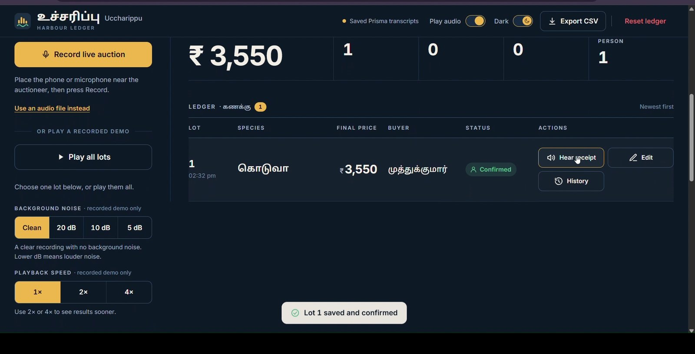
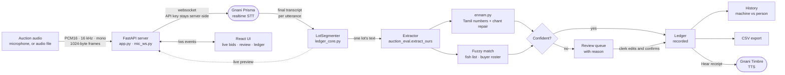

# Uccharippu (உச்சரிப்பு) · Harbour Ledger

### A voice ledger for Tamil fish auctions: it turns the shouted auction into a record people can check, and it never guesses.

Built on **Gnani Prisma** (realtime Tamil speech-to-text) and **Gnani Timbre** (Tamil text-to-speech) for the **Great Indian AI Internship Challenge**. Solo entry by Subhitcha, Coimbatore Institute of Technology.

**Demo video (2–3 min):** ADD-VIDEO-LINK-HERE




*Both screens show a test auction spoken by a synthetic voice (Gnani Timbre). They are not a real harbour auction.*

---

## 1. The problem

At a fish auction the price is not typed. It is **shouted**, in a fast, rising, repeated chant, while other buyers call out at the same time. One clerk writes it down by hand. When the lot is gone, that page is the **only record** the fisherman, the auctioneer and the harbour society will ever have.

That makes it more than a speech-to-text problem. Three things go wrong at once:

- **The price is never said cleanly.** It is a chant ("மூணாயிரத்து நானூறு… நானூறு… ஐநூறு"), spoken in colloquial number forms, with thousands often dropped.
- **The result must be trusted.** A wrong digit is a money dispute. A silent guess is worse than a blank.
- **Nothing is checkable later.** A paper line has no trail: who heard what, who changed it.

Generic transcription does not solve this. A transcript is not a lot, and a lot is not a record.

## 2. The solution

Uccharippu listens beside the auction, so **nobody has to change how they auction**, and builds the record while the chant is still going.

| Stage | What happens |
|---|---|
| **Listen** | Audio streams to Gnani Prisma. We ask for the *verbatim* transcript, because we parse the numbers ourselves (see section 4). |
| **Segment** | The text stream is cut into lots by the auction's own grammar: *fish name · "ஸ்டார்ட் ஆகுது" · prices · closing word · "பேரு?" · buyer*. |
| **Understand** | Spoken Tamil numbers become integers. The repeated, rising chant is repaired into a clean list of bids. The buyer is matched to the roster. |
| **Decide** | Each lot is either **recorded** or sent to **review** with a plain-language reason. There is no third option where the system quietly guesses. |
| **Keep** | A person confirms or edits. The machine's original answer is never overwritten. Every edit is kept in a history. |
| **Read back** | The clerk can hear the lot read back in Tamil (Gnani Timbre) and check it by ear. |

## 3. Architecture



- **The browser never talks to Prisma and never sees the key.** The server holds the credential and fans events out to every open screen.
- **Only final transcript text reaches the segmenter.** Partial text is shown on screen but never counted, because the recogniser revises partials and a revised word would be counted twice.
- **One interface, two sources.** `stt_stream.py` offers a live `PrismaStream` and a `SavedStream` that replays saved Prisma transcripts at the pace of the audio. The same code path serves the demo, the tests and the live system, and the UI badge always says which one is running.
- **The core has no network and no web framework.** `ledger_core.py`, `ennam.py` and `auction_eval.py` are plain Python and fully unit-tested offline.

## 4. How it works, and why it is built this way

| Problem in a real auction | Design decision | Why |
|---|---|---|
| Prisma's Tamil number formatting breaks on the common `-த்தி` thousand form (for example "ஆறு ஆயிரத்தி நானூறு" comes back as "6 ஆயிரத்தி ₹400"). | Request the **verbatim** transcript and parse the spoken numbers ourselves in `ennam.py`. Salvage the formatter's garbled digits when they appear. | The words are reliable even when the digits are not. We control the number logic, so we can test it. |
| The price is a **chant**: the same value several times, rising by small steps, in colloquial forms ("அஞ்சூறு", "எட்டரை"). | `repair_chant` uses the auction's own rules: bids rise in steps of 50, a small fall is tolerated and flagged, and a far-off clean price means a **new lot**. It repairs an extra zero, a dropped leading digit and the "X-அரை" shorthand. | The chant carries its own error correction. Repetition is evidence. |
| One misheard fragment must not poison the lot. | Fragments ("0", "49", "10") are marked **suspect** and **do not move the reference price**. A repair is accepted only with strong evidence: it must land on a repeat or within two steps of the last bid. | A bad token stays contained. |
| **Confidence** is the hard part. | The chant is the confidence signal. A final price called **at least twice** in a row, unrepaired, is trusted. A price heard **once**, or one that needed a repair, is **flagged**. | It is a rule a clerk can understand and a judge can audit. It does not hide behind a hidden score. |
| Buyer names are a **closed set** (the harbour's roster) and sound alike. | Fuzzy match against the roster with a **margin rule**: flag when the best match is weak, or nearly tied with the runner-up. A word that matches a roster name at least as well as it matches the prompt "பேரு" is treated as a name. | In a closed set, the gap to the runner-up says more than raw similarity. Found and fixed during testing: "பீட்டர்" was once mistaken for the prompt and left the buyer empty. |
| The recogniser answers per **utterance**, not per lot, and a lot can split in two. | `LotSegmenter` finishes a lot on the first closing word or "பேரு?" followed by a clear roster name. Otherwise it finishes on the **next lot's start phrase**, or on silence, or when the audio ends, and flags those cases. A lot is never silently merged into the next one. | The segmenter follows the auction's grammar, not the recogniser's pauses. |
| A public URL must not burn someone's credits. A microphone left on must not run forever. | `PLAY_TOKEN` guards live playback and the mic. Mic sessions end after `MIC_MAX_S`. Live audio is streamed at the pace it is spoken. | Failure should be safe and cheap. |
| A silent mistake is the worst outcome. | Missing fields show as **"Buyer missing"**, never a blank. Inline Edit saves a correction only. A person confirms separately. | Review is part of the product, not an afterthought. |

**Discipline in testing.** The number parser was developed on one set of scripted lots and checked on held-out lots it had not seen. The review thresholds were fixed before any real Prisma output was used. The test audio is synthetic and labelled that way everywhere. We do **not** publish accuracy, latency or cost figures: Gnani's terms require written consent first, and a validation on real harbour audio is the plan (section 7).

## 5. What the product shows

- **Live lot board** with five honest states: *Ready, Listening, Processing, Recorded, Needs review*. It keeps the last recorded lot on screen.
- **Review queue** in plain language (no flag codes): "buyer name unclear", "final price heard only once", "no closing word heard", "final price was repaired: check it".
- **Ledger** of lot records: fish, final price, buyer, status, with labelled buttons.
- **History as a timeline**, machine versus person, and a **CSV export** with the machine's answer next to the final value.
- **Spoken receipt**: fish, price in Tamil words, buyer.
- Works on a phone, in light and dark themes, with Tamil fonts bundled so nothing is fetched from the internet.

## 6. Run it

**No API key, two minutes** (replays saved Prisma transcripts of six synthetic test lots; lot 63 shows the review queue):

```bash
pip install -r requirements.txt
uvicorn app:app --port 8000          # open http://localhost:8000, press "Play all lots"
```

**Live mode** (streams audio to Prisma for real, enables the microphone and the spoken receipt):

```bash
export GNANI_API_KEY="<your key>"    # PowerShell: $env:GNANI_API_KEY = "<your key>"
export STT_MODE=live
uvicorn app:app --port 8000          # badge: LIVE · Prisma
```

Other settings: `PLAY_TOKEN`, `TTS_VOICE`, `MIC_MAX_S`, `CORS_ORIGINS`. The old single-file UI is at `/legacy`.

**Tests**

```bash
python test_app.py          # ALL 33 CHECKS PASSED   ledger, review flags, corrections, CSV, server
python test_receipt.py      # RECEIPT TESTS PASSED   spoken receipt, caching, key only in the header
python test_live_mock.py    # LIVE-PATH TESTS PASSED mock speech server: headers, 1024-byte framing, early close, server errors reach the UI
```

## 7. Honest status, and the pilot we are asking for

**What exists:** a working prototype, from audio in to a confirmed, auditable ledger, tried on **test auctions**: scripted Tamil chants spoken by a synthetic voice (Gnani Timbre), clean and with added noise.

**What is not proven:** performance on **real harbour audio**, real dialects, real crowd noise and real speakers. The bid rule (steps of 50) and the lot grammar (closing word, then "பேரு?") come from public auction videos and need confirming at a real harbour. The colloquial number spellings are not verified against any one harbour's dialect. The fish list and buyer roster are fixed files; a new harbour needs its own.

**The pilot.** One harbour society, fishing cooperative or fisheries institution lets Uccharippu **listen beside one auction** while the clerk keeps the paper record as usual. That single session gives:

1. real audio and dialect, which turns the assumptions above into findings;
2. the clerk's own page as the **answer key**, so we can report what was right, what was flagged and what was missed;
3. the clerk's feedback on the review queue, which decides what to build next.

**Who benefits:** the **fisherman** gets a record of what his catch sold for. The **auctioneer** keeps the auction moving. The **clerk** reviews doubtful lots instead of transcribing every one. The **society** gets a record it can check.

If you run, or know, such an auction, please reach out through the GitHub profile below.

## 8. Repository

| Path | What it is |
|---|---|
| `app.py`, `mic_ws.py`, `frontend_mount.py` | FastAPI server, live microphone socket, frontend mount |
| `stt_stream.py` | Prisma websocket client, and the saved-transcript replay stream |
| `ledger_core.py` | Lot segmentation, ledger with audit trail, CSV, receipt text |
| `ennam.py` | Spoken-Tamil number parser and chant repair |
| `auction_eval.py` | Bid, buyer and review-flag extraction (`extract_ours`), plus the evaluation harness |
| `frontend/` | React + TypeScript + Vite source; the built app is in `frontend/dist`, so Node is not needed to run |
| `demo/` | Six synthetic test lots at four noise levels, with saved Prisma transcripts |
| `tools/make_synth_chants.py` | Generates the synthetic test auctions with Gnani Timbre (needs a key and `pip install numpy`) |
| `auction_script_val2.json`, `make_script.py` | The test script, its answer key, and number-to-Tamil words |
| `roster.json`, `species_ta.json` | The buyer roster and the fish list |

Rebuild the frontend with Node 18+: `cd frontend && npm install && npm run build`.

## 9. Credits and licence

Speech recognition and voices by **Gnani.ai** (Prisma, Timbre). The speech models are theirs. Everything after the transcript is ours: number parsing, chant repair, segmentation, review rules, ledger, audit trail and interface. Fonts Inter and Noto Sans Tamil are bundled under the SIL Open Font License. Code is MIT, see `LICENSE`. All names in the demo are fictional.

**Subhitcha** · [github.com/Subhitcha04](https://github.com/Subhitcha04)