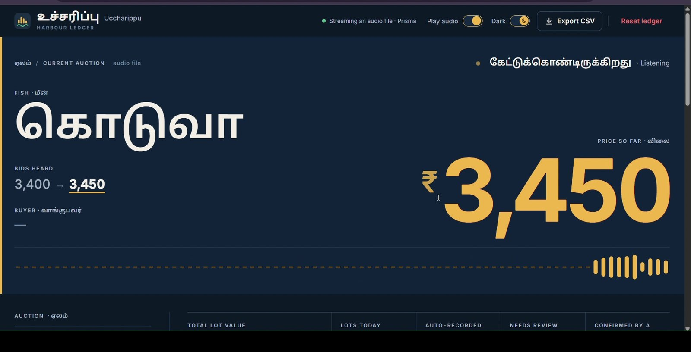
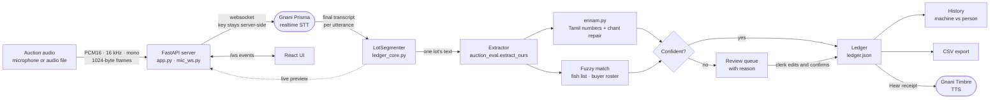

# Uccharippu (உச்சரிப்பு) · Harbour Ledger

### Turning spoken Tamil fish auctions into structured, reviewable transaction records.

Uccharippu listens beside a fish auction, follows the shouted bids, and writes each lot (fish, final price, buyer) into a ledger. When it is unsure, it asks a person instead of guessing, and it keeps every correction next to what the machine heard.

Built with **Gnani Prisma** (Tamil speech-to-text) and **Gnani Timbre** (Tamil text-to-speech) for the Great Indian AI Internship Challenge. Solo entry by Subhitcha, Coimbatore Institute of Technology. Python · FastAPI · React · TypeScript.

**Demo video (2 min):** https://drive.google.com/file/d/1Z0r18jAoZS-L1bv-hTHVb7_7RUQLiESq/view


*A test auction in progress. The price follows each bid as it is called.*

> **Status: prototype.** Everything shown here uses **synthetic test auctions** (scripted Tamil chants spoken by Gnani Timbre). No real harbour audio has been tested yet. See [Limitations](#13-limitations-and-current-scope).

---

## Contents
1. [The problem](#1-the-problem) · 2. [The solution](#2-the-solution) · 3. [See it in action](#3-see-it-in-action) · 4. [Architecture](#4-system-architecture) · 5. [Implementation](#5-technical-implementation) · 6. [The auction intelligence layer](#6-the-auction-intelligence-layer) · 7. [Engineering decisions](#7-engineering-decisions-and-trade-offs) · 8. [Evaluation and testing](#8-evaluation-and-testing) · 9. [Failure handling](#9-failure-handling-and-reliability) · 10. [Setup](#10-installation-and-local-setup) · 11. [Project structure](#11-project-structure) · 12. [Feature status](#12-feature-status) · 13. [Limitations](#13-limitations-and-current-scope) · 14. [Roadmap](#14-roadmap) · 15. [Real-world adoption](#15-real-world-impact-and-a-proposed-pilot) · 16. [Privacy](#16-privacy-responsible-use-and-data-handling) · 17. [Credits](#17-acknowledgements)

---

## 1. The problem

At a fish auction the price is not typed. It is **shouted**, as a fast, rising, repeated chant, while several buyers call out at once. Someone has to write it down by hand. When the lot is gone, that page is often the only record of what the catch sold for.

The difficulty is not just transcription. The price arrives as spoken Tamil in colloquial number forms, repeated several times, sometimes cut off or misheard. The record that matters is a *lot*: which fish, what final price, which buyer.

| Who | What they need |
|---|---|
| **Fishermen** | A clear record of what their catch sold for. |
| **Auctioneers** | To run the auction without stopping to document it. |
| **Auction clerks** | A manageable way to turn spoken bids into a record, and a way to see what needs checking. |
| **Harbour societies and cooperatives** | Structured, traceable information they can verify later. |

Uccharippu does not claim to remove disputes or guarantee transparency. It aims to make the record more complete, and the points of doubt visible.

## 2. The solution

Uccharippu is **not a transcription app**. It separates six jobs that a generic speech-to-text tool leaves undone:

1. **Speech recognition**: Gnani Prisma turns the audio into Tamil text.
2. **Lot segmentation**: the text stream is cut into lots using the auction's own grammar (fish name, start phrase, prices, closing word, "பேரு?", buyer).
3. **Bid tracking**: spoken Tamil numbers become integers and the repeated chant is repaired into a clean list of bids.
4. **Buyer identification**: the name spoken after the buyer prompt is matched against a roster. (It reads a spoken name. It does not identify bidders by voice.)
5. **Recording**: the lot is written to a ledger, or sent to a review queue with a reason.
6. **Human review**: a person confirms or edits, and every change is kept as history.

It listens beside the auction, so nobody changes how they auction.

## 3. See it in action

**Step by step** (screenshots are from a live run with Prisma streaming; the voice is synthetic):

1. **Auction audio in.** A test lot plays in real time, or a microphone feeds the same path.
2. **Speech recognition.** Prisma's transcript appears live; only final text is used for the record.
3. **Fish and price progression.** The board shows the fish (கொடுவா) and the bids heard so far, 3,400 → 3,450 → 3,500 → 3,550.
4. **Buyer and final price.** After the closing word and "பேரு?", the buyer's name (முத்துக்குமார்) is matched to the roster.
5. **Ledger.** The lot is recorded with a status. Doubtful lots go to the review queue.


*What to notice: fish, final price and buyer in one row; a "Confirmed" status set by a person; and buttons for the spoken receipt, edit and history.*

When a lot is unclear (for example a garbled buyer name), it goes to the **review queue** with a plain-language reason instead of being guessed.

## 4. System architecture



| Component | Responsibility | Input → output |
|---|---|---|
| `stt_stream.py` | `PrismaStream` (live websocket) and `SavedStream` (replays saved Prisma transcripts at the audio's pace). Same interface for both. | PCM frames → `Transcript(text, is_final)` |
| `ledger_core.LotSegmenter` | Cuts the final-text stream into lots. | final text → finished lots (+ live preview) |
| `auction_eval.extract_ours` | Reads one lot's text: fish, bid sequence, final price, buyer, review reasons. | lot text → record + flags |
| `ennam.py` | Spoken-Tamil numbers to integers; chant repair. | text → numbers → repaired bids |
| `ledger_core.Ledger` | The book: lots, status, corrections, history, CSV. Persisted to `ledger.json`. | lots + edits → records |
| `app.py` | HTTP and websocket server; fans events out to every open screen; spoken receipt. | UI messages ↔ events |
| `mic_ws.py` | Live microphone: browser PCM over `/ws/mic` into the same path. | PCM frames → Prisma |
| `frontend/` | React UI: lot board, review queue, ledger, history. | events → screens |

**Validation and errors.** Validation happens in the extractor (confidence rules and name-match thresholds), not in the UI. Server errors from Prisma are raised as `StreamError` and shown to the user rather than silently ending the stream.

## 5. Technical implementation

- **Gnani Prisma (STT).** Live path: `wss://api.vachana.ai/stt/v3/stream` with the API key and `lang_code: ta-IN` headers; raw PCM16 at 16 kHz in 1024-byte frames, at the pace the audio is spoken. The server answers per utterance after it hears silence, so the client closes once every started utterance has been answered and the line is quiet (with a hard maximum wait). The format requested is *verbatim*, because the number parsing is done here (section 7).
- **Gnani Timbre (TTS).** Two uses: the **spoken receipt** (`/api/receipt/{lot}`: fish, price in Tamil words, buyer; cached on disk by text and voice) and the **synthetic test audio** generator `tools/make_synth_chants.py`, which has several voices play auctioneer and bidders over a background.
- **Audio handling.** Audio is converted to 16 kHz mono PCM16 and framed. Clips get trailing silence so the server's voice-activity detection ends the utterance. A microphone supplies its own.
- **Backend.** FastAPI and uvicorn, websockets for Prisma and for the UI. In-memory ledger with JSON persistence (`ledger.json`); there is no database.
- **Frontend.** React 18, TypeScript, Vite. The built app is committed in `frontend/dist`, so Node is not needed to run it. Fonts (Inter, Noto Sans Tamil) are bundled.
- **Core logic is framework-free.** `ledger_core.py`, `ennam.py` and `auction_eval.py` have no network or web dependency and are unit-tested offline.

## 6. The auction intelligence layer

This is application logic and rules. It is **not** a trained model of ours, and it is not presented as one.

| Need | How it is done (rules and heuristics) |
|---|---|
| **Fish names** | The first words of a lot are fuzzy-matched (normalised Tamil, gemination folded) to a fixed fish list. A weak or near-tied match raises `species?`. |
| **Spoken numbers** | `ennam.parse_numbers` reads Tamil number words, including colloquial forms (அஞ்சூறு, எட்டரை, ஆயிரத்தி forms) and salvages digit text. |
| **Repeated, changing bids** | `repair_chant` assumes bids rise in steps of 50. It tolerates and flags small falls, treats a far-off clean price as a **new lot**, and repairs an extra zero, a dropped leading digit and "X-அரை" shorthand. A repair needs strong evidence (land on a repeat or within two steps). Fragments are marked *suspect* and never move the reference price. |
| **Final outcome** | The last good price. If it was called **at least twice** in a row, unrepaired, it is trusted. Called once, or repaired, it is flagged. |
| **Buyer names** | The word after the buyer prompt is matched to a **closed roster** with a margin rule: weak, or nearly tied with the runner-up, raises `buyer?`. |
| **Ambiguous or incomplete lots** | A lot ends on a closing word plus a clear roster name. Otherwise it ends at the next lot's start phrase, on silence, or when the audio ends, and is flagged with the reason. |

The bid step of 50 and the lot grammar come from a few public auction videos. They are **assumptions to confirm at a real harbour**.

## 7. Engineering decisions and trade-offs

- **Why voice, not data entry?** The clerk's hands and attention are already busy, and the auction should not slow down. The trade-off: the system depends on audio quality and network for live use.
- **Why verbatim output and our own number parser?** Prisma's Tamil number formatting can break on forms like "ஆறு ஆயிரத்தி நானூறு", so the product uses the verbatim words and parses them itself, where the logic is testable. Trade-off: more code to maintain; dialect forms must be added by hand.
- **Why not word boosting in the product path?** The evaluation harness compared a plain verbatim path with one that biases Prisma towards the fish and buyer words. The product uses the plain path (no boosting) so that its behaviour is the one that was evaluated.
- **Wrong Tamil words and number mistakes.** Handled by fuzzy matching, the repair rules and, above all, **flagging**: the system prefers "ask a person" to a confident wrong answer.
- **Overlapping bids.** Not solved. There is no speaker separation. Cross-talk can garble a lot, which the review rules are meant to catch.
- **Uncertain transaction.** Shown as a *Needs review* lot with a plain-language reason. Missing fields show "missing", never blank.
- **Where a human is required.** Every flagged lot, and any lot a clerk wants to correct. Confirming is a separate action from editing.
- **Trade-off of rules over a model.** Rules are inspectable and testable, but they encode assumptions (step of 50, closing words) that must be re-checked for each harbour.

## 8. Evaluation and testing

**What exists.** (1) Unit and integration tests; (2) an evaluation harness; (3) live runs on synthetic audio.

| Check | Command | What it covers |
|---|---|---|
| `test_app.py` | `python test_app.py` | 33 checks: ledger, review flags, corrections and history, CSV, server routes. |
| `test_receipt.py` | `python test_receipt.py` | Spoken receipt request, key only in header, repaired reply, caching. |
| `test_live_mock.py` | `python test_live_mock.py` | The live path against a **mock** speech server: headers, framing, early close, errors reach the UI. |

These tests prove the code's behaviour. They are **not** a measure of recognition accuracy on real audio.

**Evaluation harness.** `auction_eval.py` scores the extractor against an answer key (`auction_script_val2.json`) over scripted lots at four noise levels (clean, 20, 10 and 5 dB), with a development / held-out split. It measures **entity extraction** (fish, final price, buyer, whole lot) and **review-flag behaviour**, which is a different thing from transcription quality (WER or CER). WER and CER were not measured.

**Results are not published here.** Gnani's terms require written consent before accuracy, latency or cost figures are published, so none appear in this repository. The test audio is synthetic, the lot count is small, and these runs say little about real harbour speech. **No latency benchmark exists.**

## 9. Failure handling and reliability

| Situation | Current behaviour (implemented) |
|---|---|
| Unclear audio, fish or buyer mismatch | Lot goes to review with `species?` / `buyer?`; nothing is guessed. |
| Wrong or doubtful number | A price heard once, repaired, or fragmentary is flagged. |
| Incomplete lot | Ended on silence, next-lot start or end of audio, and flagged with the reason. |
| STT error (bad key, missing header, quota) | Raised as `StreamError`, shown in the UI. Tested against the mock server. |
| Network unavailable in live mode | The error is shown. There is **no automatic fallback**; saved-transcript mode is a manual switch (`STT_MODE=saved`). |
| Lot split into two utterances | Both are collected and the whole lot is returned. |
| Correction needed | Inline edit, then separate confirm. The machine's answer is kept in `original`, every change in `history`. |
| Public URL, mic left on | `PLAY_TOKEN` guards live playback and the mic; mic sessions end after `MIC_MAX_S`. |
| Server restart | The ledger is reloaded from `ledger.json`. |

**Recommended before production, not implemented:** automatic reconnect and buffering, a real database, authentication and roles, per-harbour vocabulary management, and audio retention controls.

## 10. Installation and local setup

**Prerequisites.** Python 3.10 or newer (developed on Windows and PowerShell; the test suite here was run on Python 3.13). A Gnani API key is needed only for live mode, the microphone, the spoken receipt and the audio generator. See `.env.example`.

```powershell
git clone <this repository>
cd uccharippu
python -m venv .venv ; .\.venv\Scripts\Activate.ps1      # bash: python -m venv .venv && source .venv/bin/activate
pip install -r requirements.txt
python -m uvicorn app:app --port 8000                    # open http://localhost:8000
```

Press **Play all lots**. This is **saved mode**: the six synthetic test lots are replayed in real time with saved Prisma transcripts (the badge says so). No key and no credits needed. The older single-file UI is at `/legacy`.

**Live mode**

```powershell
$env:GNANI_API_KEY = "<your key>"
$env:STT_MODE = "live"
python -m uvicorn app:app --port 8000                    # badge: LIVE · Prisma
```

Environment variables: `GNANI_API_KEY`, `STT_MODE`, `PLAY_TOKEN`, `TTS_VOICE`, `MIC_MAX_S`, `CORS_ORIGINS`, `PRISMA_LOG`, plus tuning `PRISMA_TAIL_S`, `PRISMA_QUIET_S`, `PRISMA_PAD_S`.

**Tests:** `python test_app.py`, `python test_receipt.py`, `python test_live_mock.py` (no key needed). **Frontend rebuild** (Node 18+): `cd frontend; npm install; npm run build`.

## 11. Project structure

```
app.py               FastAPI server, websocket hub, spoken receipt, CSV
mic_ws.py            live microphone socket
stt_stream.py        Prisma client + saved-transcript replay
ledger_core.py       lot segmentation, ledger, audit trail, CSV
ennam.py             spoken-Tamil numbers, chant repair
auction_eval.py      extraction rules (extract_ours) + evaluation harness
make_script.py       test script generator, number-to-Tamil words
auction_script_val2.json   test script and answer key
roster.json, species_ta.json   buyer roster and fish list
demo/                six synthetic lots x four noise levels + saved Prisma transcripts
frontend/            React + TypeScript source; frontend/dist is the built app
static/              legacy single-file UI
tools/make_synth_chants.py   synthetic auction generator (Gnani Timbre)
test_app.py, test_receipt.py, test_live_mock.py
docs/                screenshots used in this README
```

## 12. Feature status

| Feature | Status |
|---|---|
| Prisma realtime streaming, per-utterance final text | Implemented, run with synthetic audio |
| Lot segmentation, bid repair, buyer matching, review flags | Implemented and unit-tested |
| Ledger with history, confirm/edit, CSV export | Implemented and unit-tested |
| Spoken receipt (Timbre) | Implemented; request path tested with a mock |
| Live microphone | Implemented; not tested with real harbour audio |
| Real harbour audio, real dialects, real crowd noise | **Not tested** |
| Overlapping-speaker handling, voice-based bidder identification | **Not implemented** |
| Accuracy and latency benchmarks | **Not published** |
| Database, auth, offline mode, multiple halls | **Planned** |

## 13. Limitations and current scope

**Current implementation:** one auction stream, `ta-IN` only; fixed fish list and buyer roster; JSON file storage; a single process; live use needs a network and a key; every flagged lot needs a person.

**Untested assumptions:** bids rise in steps of 50; lots end with a closing word and "பேரு?"; the colloquial number spellings are not verified against any one harbour's dialect; recognition quality under real harbour noise and overlapping speech is unknown.

**Opportunities:** see the roadmap.

## 14. Roadmap

**Immediate:** a real harbour pilot with consent; domain-specific audio and a fair evaluation against the clerk's own record; per-harbour fish and buyer vocabulary; resilient reconnection.

**Later:** better handling of overlapping speech; export and reporting for cooperatives; cooperative-level dashboards; integration with existing fisheries workflows; more languages.

## 15. Real-world impact and a proposed pilot

Structured voice records could give each stakeholder something the paper page cannot: the fisherman a record of the sale, the clerk a short review list instead of full transcription, and the society a history showing what was heard and what a person changed.

**Proposed validation (not yet done):**
1. Observe an existing auction and the clerk's workflow.
2. Work with the auctioneer and clerk; collect representative audio **with consent**.
3. Compare generated records with the manually verified record.
4. Measure recognition accuracy, extraction accuracy, latency and correction effort.
5. Gather feedback from fishermen and cooperative representatives, improve, then widen.

If you run or know such an auction, please get in touch.

## 16. Privacy, responsible use and data handling

- **Audio.** In live mode, auction audio (a file or the browser microphone) is streamed through this server to **Gnani Prisma**. The server writes no incoming audio to disk. Demo audio in `demo/` is synthetic.
- **Stored locally:** the ledger (`ledger.json`), spoken-receipt audio cache (`receipts/`), and a log of Prisma messages including transcripts (`live_log.jsonl`; disable with `PRISMA_LOG=`). The key is redacted from the log.
- **Credentials.** The key is read from an environment variable and sent only in headers to Gnani. The browser never sees it. No key is in this repository.
- **Not verified or implemented:** encryption at rest, retention and deletion policies, user authentication. Before a real harbour: informed consent from auction participants, a retention policy, authenticated access, and a review of Gnani's data terms.

## 17. Acknowledgements

Speech recognition and voices are provided by **Gnani.ai** ([gnani.ai](https://www.gnani.ai)) through its Prisma and Timbre APIs, used for the Great Indian AI Internship Challenge. This is an independent entry, **not an official Gnani product**, and implies no partnership or endorsement. Fonts Inter and Noto Sans Tamil are bundled under the SIL Open Font License. Libraries: FastAPI, uvicorn, websockets, requests, React, Vite. Code is MIT (`LICENSE`). All names in the demo are fictional.

---

Uccharippu is not trying to change how fish auctions happen. It is exploring how the transactions that already happen every day can be captured, organised and reviewed more reliably. Technical feedback and harbour pilot collaboration are very welcome, by opening an issue on this repository.

**Subhitcha** · CIT Coimbatore